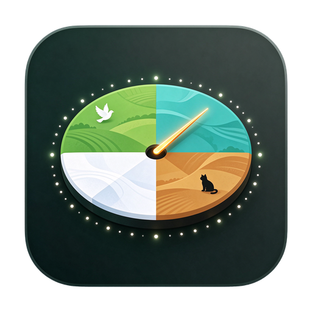
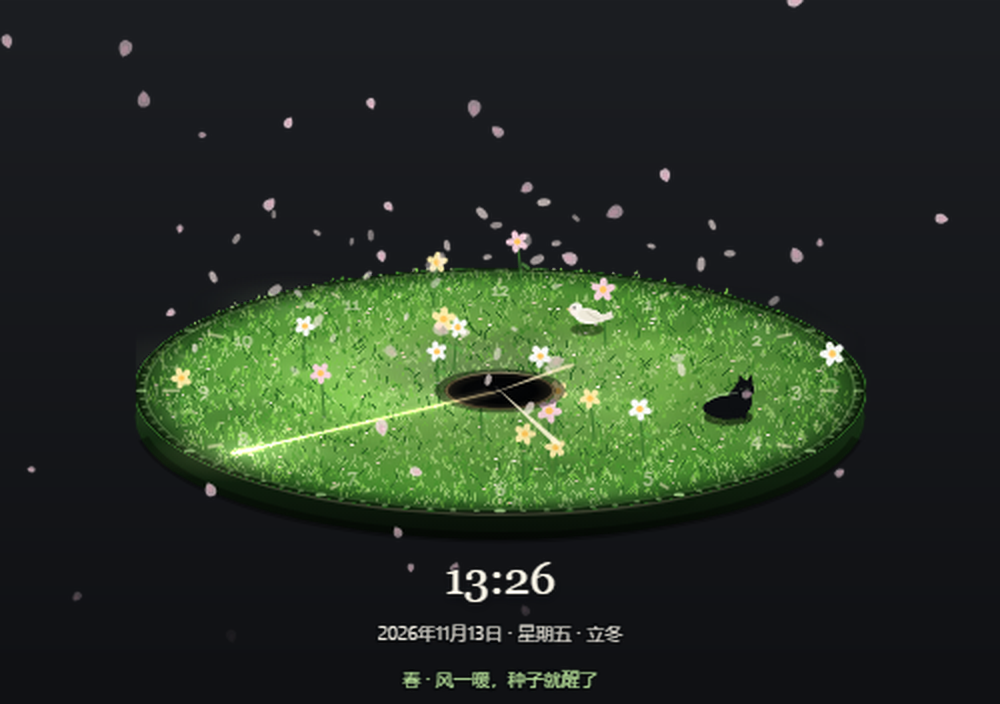
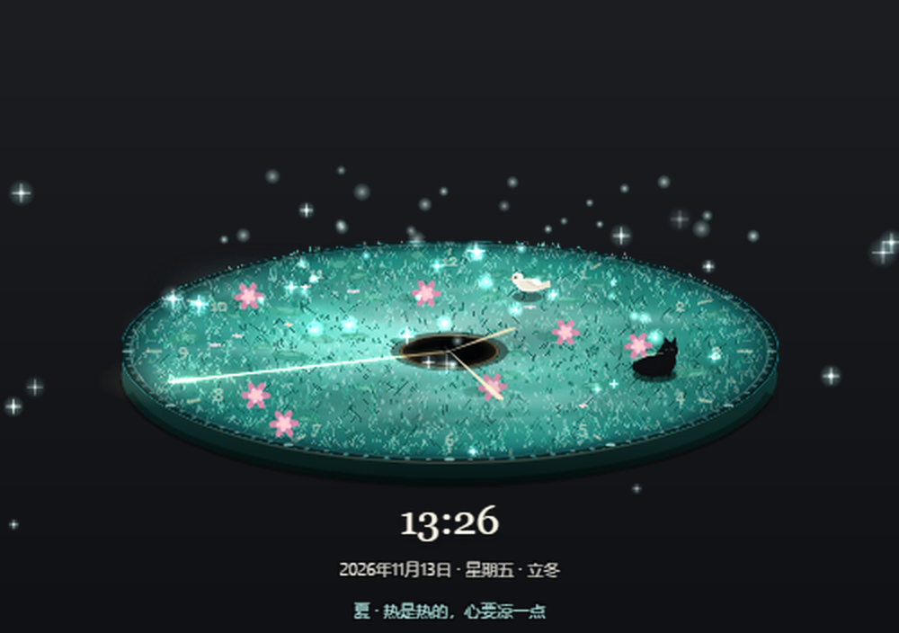
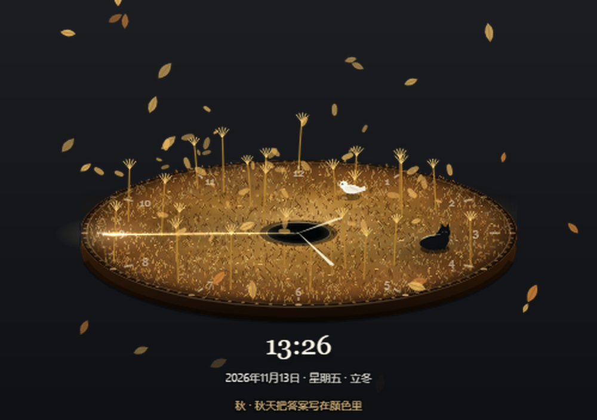
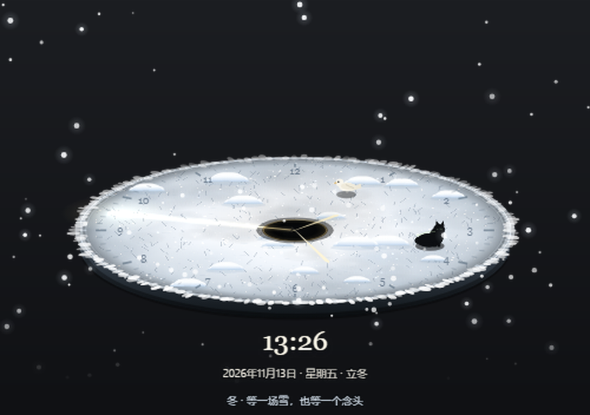
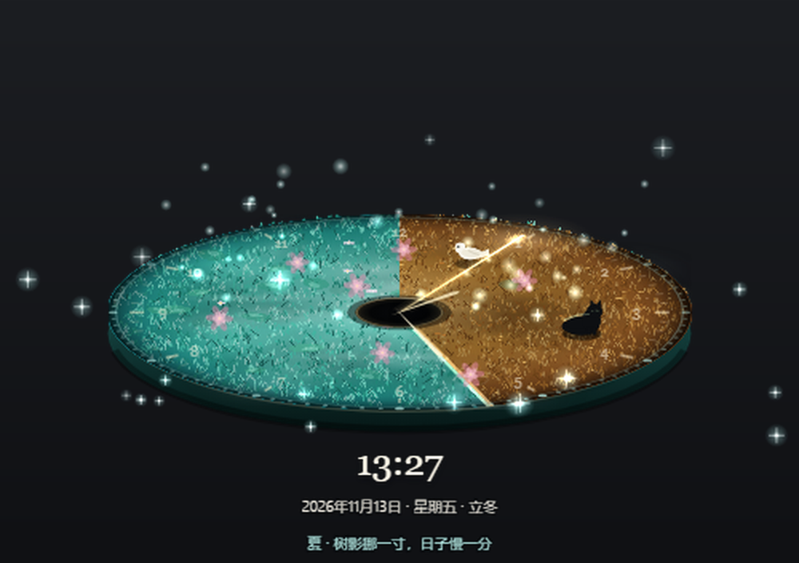
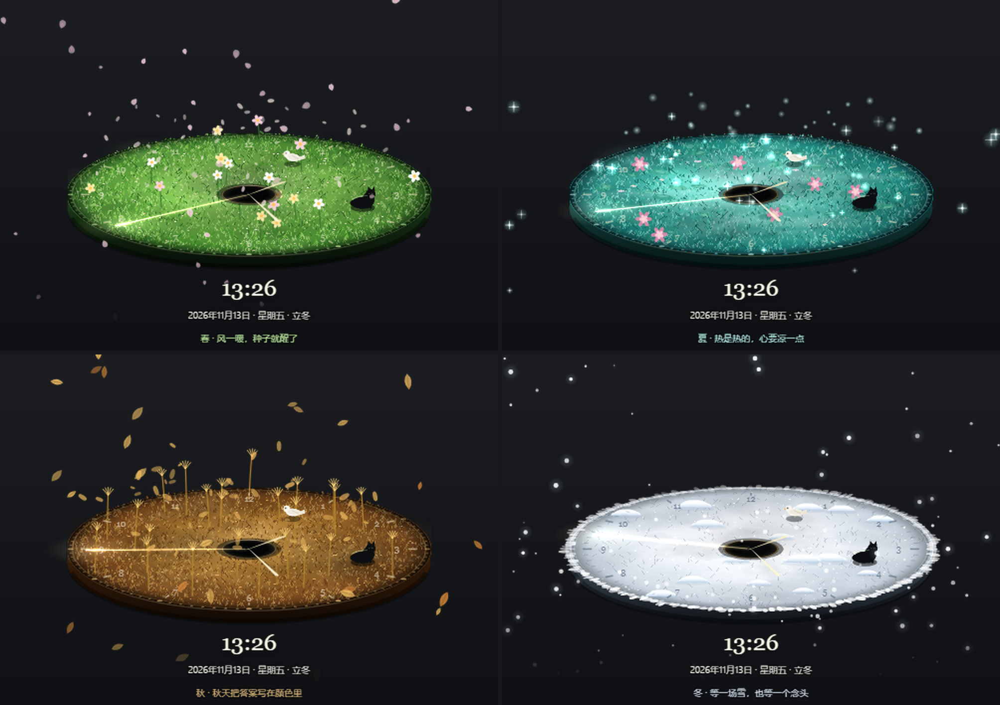

# SeasonDial · 四季转盘

<p align="center">
  
</p>

<p align="center">
  A four-season desktop clock pet for Windows.<br />
  An oval seasonal island floats on your desktop; a golden needle sweeps the ground from spring green into summer teal, autumn amber and winter snow — while the time, date and a healing line of text sit underneath.
</p>

<p align="center">
  <a href="README.md">简体中文说明</a> ·
  <a href="docs/manual.zh-CN.md">完整使用说明</a>
</p>

| Spring | Summer | Autumn | Winter |
| :---: | :---: | :---: | :---: |
|  |  |  |  |

The wedge that hands the ground over to the next season, and the three sizes side by side:

| Season sweep | Sizes S / M / L |
| :---: | :---: |
|  |  |

---

## What it is

A frameless, transparent, always-on-top Electron window that draws everything with Canvas 2D — no images, no game engine, ~6k lines of vanilla JS and one `main.js`.

The disc is an oval "island": a grass plate with a dark hole as the clock hub, a golden beam running from the hub to the rim acting as the second hand, a ring of light beads as tick marks, a small black cat and a white dove living on the surface.

Two independent cycles run at once:

| Cycle | What it does |
| --- | --- |
| **Second hand** (60 s / turn) | The golden beam rotates; behind it the ground is revealed season by season, so the tail of each sweep carries the colour of the season passed. |
| **Season** | Every 60 s (configurable) the whole disc wipes to the next season with a sharp, glowing wedge boundary: spring → summer → autumn → winter. |
| **Turbo spin** (optional) | The beam speeds up to one turn in 15 s and hands the ground over every time it passes 12 o'clock, so all four seasons run past in 15 s. Visual only — the clock underneath keeps real time. |

## Features

- **Real seasons, computed properly** — "follow the real season" uses the sun's apparent ecliptic longitude (low-precision Meeus) to find the exact 24 solar terms in Beijing time, then picks the season from those boundaries. Verified against the official almanac for 2025–2028: same day, within 1–13 minutes.
- **Four clearly different grounds** — fresh green grass, bright midday-teal water with lotus leaves, dry amber litter, pure snow.
- **The seasons grow inside the disc** — flowers rise on their stems in spring, water lilies float in summer, rice stalks grow taller in autumn, deep drifts pile up in winter; when the season changes the new decorations grow out of the ground while the old ones fade away.
- **The cat leaves footprints** — in winter the ground is snow, and the cat's walk around the disc leaves a trail of fading paw prints that fill back in after about 26 s.
- **Sky per season** — cherry petals, rising white water glints, falling leaves with veins, snow; all of them fade out as they drift below the disc, so nothing is chopped off at the window edge.
- **Watch all four seasons quickly** — right-click "Season → Turbo spin": one turn in 15 s, a new season at every 12 o'clock, purely visual and without touching the clock reading.
- **The cat and the dove keep a schedule** — they curl up and sleep (with floating `z`) at night, loaf and blink by day, pace and flap at dawn and dusk.
- **Healing lines, original** — six original lines per season, rotating every 26 s with a cross-fade, never repeating back-to-back and always swapped when the season changes.
- **Readable on any wallpaper** — all three lines of text carry a dark outline plus a tight drop shadow, so they stay legible on a pure white window as well as a dark desktop.
- **Three sizes** — small 380×268, medium 500×352, large 650×458, scaled around the window centre and clamped into the work area.
- **Light on the CPU** — 30 fps cap, cached base layer, per-season wedge compositing instead of full redraws: measured 18–23 % of one core on a 16-core machine, and drawing stops entirely when hidden.
- **A tip jar** — "Tip the author" in both the right-click menu and the tray opens a WeChat reward QR code.

## Download

Grab the latest portable build from [Releases](https://github.com/92lyzxx/season-dial/releases): `SeasonDial-1.2.0.exe`.

It is a portable single-file build — no installer, no admin rights. Windows may show a SmartScreen warning because the binary is unsigned: *More information → Run anyway*.

## Build from source

```bash
npm install
npm start          # run with Electron directly
npm run pack       # build the portable exe into dist/
npm run icon       # regenerate build/icon.ico + assets/icon.png (needs Python + Pillow)
```

If `npm install` or the build is slow in mainland China, point both mirrors at npmmirror first:

```powershell
$env:ELECTRON_MIRROR = "https://npmmirror.com/mirrors/electron/"
$env:ELECTRON_BUILDER_BINARIES_MIRROR = "https://npmmirror.com/mirrors/electron-builder-binaries/"
npm run pack
```

Requirements: Node 18+, Python 3 only for the icon script.

## Controls

| Action | Result |
| --- | --- |
| Drag with the left button | Move the island; the position is remembered |
| Left click on the disc | A golden ripple spreads out |
| Right click | Menu: season mode (auto / turbo spin / follow the real season / fixed season), clock and ticks, rotation interval, size, always-on-top, click-through, autostart, tip the author, quit |
| Esc / click anywhere outside | The menu closes by itself |

On first launch the island appears in the **top-right corner** with a 24 px margin; after that it comes back where you left it.

## Tip the author

<p align="center">
  
</p>

Pick **Support → Tip the author** in the right-click menu (the tray menu has the same entry) and a WeChat reward QR code opens in its own always-on-top window. It is draggable, and closes with the button or `Esc`.

## Seasons at a glance

| Season | Ground | Sky | Moving things inside the disc |
| --- | --- | --- | --- |
| Spring | Fresh yellow-green grass | Cherry petals drifting | Small flowers rise on stems and sway |
| Summer | Bright midday teal water, lotus leaves and water lilies | White glints rising off the water | Lotus blossoms float on the water, pads and ripples rocking |
| Autumn | Dry amber earth | Falling leaves with veins | Rice stalks grow taller and put out ears |
| Winter | Pure snow cover | Snowflakes and soft glow | Snow drifts pile up, the cat leaves paw prints; snow on the rim, dark tick marks |

## Performance

Measured on 1920×1080, medium size, 16-core CPU:

| Metric | Value |
| --- | --- |
| FPS | 30 (capped; `?fps=60` when running from source) |
| CPU | 18–23 % of one core (≈1.2–1.5 % of total) |
| Memory | ~430 MB working set across five Electron processes |
| Idle behaviour | Rendering stops when the page is hidden |

Memory is Electron's baseline rather than leaked canvas resources; it does not keep climbing.

## Project layout

```
main.js                 # window, tray, IPC, window-state persistence
preload.js              # contextBridge -> window.pet.{send,invoke,on}
renderer/
  index.html
  style.css             # the right-click menu
  app.js                # everything drawn here: palette, textures, seasons, cat & dove, hands, menu
build/icon.ico          # Windows icon, 7 sizes, small sizes use a simplified crop
assets/icon.png         # tray icon
tools/                  # dev-only: offline screenshots, solar-term probe, icon generator
docs/                   # screenshots and the Chinese manual
```

## How the season is computed

`solarTermOf(date)` solves the sun's apparent longitude with Meeus' low-precision formulas, converts the timestamp to UTC+8 and reads the Beijing wall-clock instant of each term. Season boundaries are 立春 (spring), 立夏 (summer), 立秋 (autumn) and 立冬 (winter); `tools/verify_terms.js` prints the table this build was checked against.

## License

[MIT](LICENSE) © 2026 溪行 (Xixing)

The four seasons' lines of text are original, written for this project.
