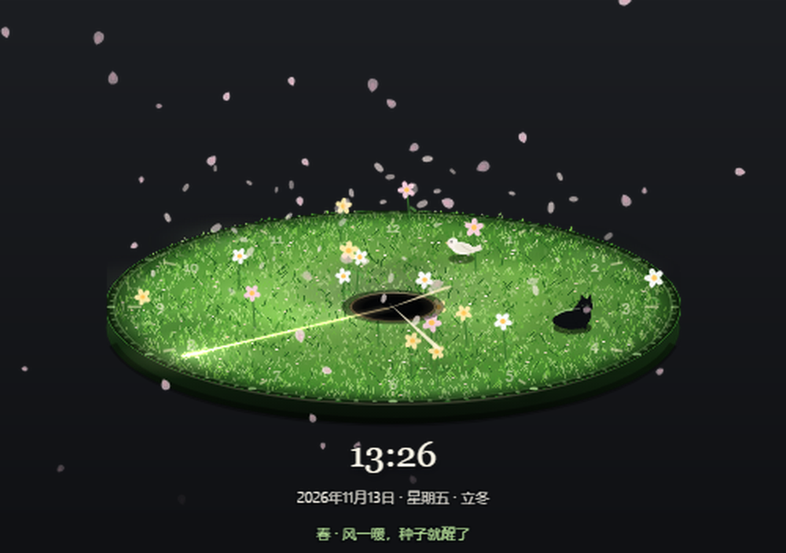
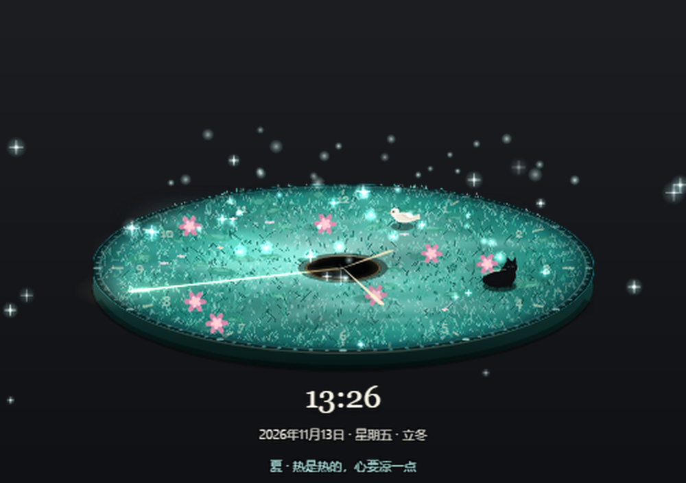
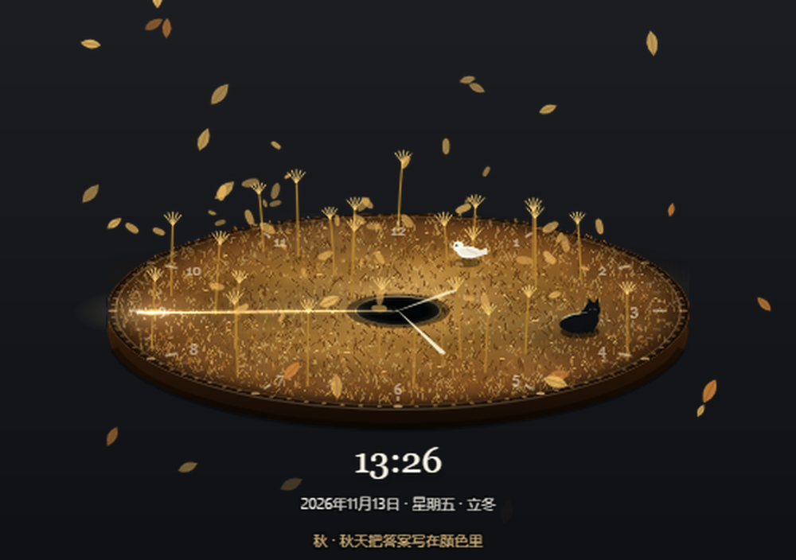
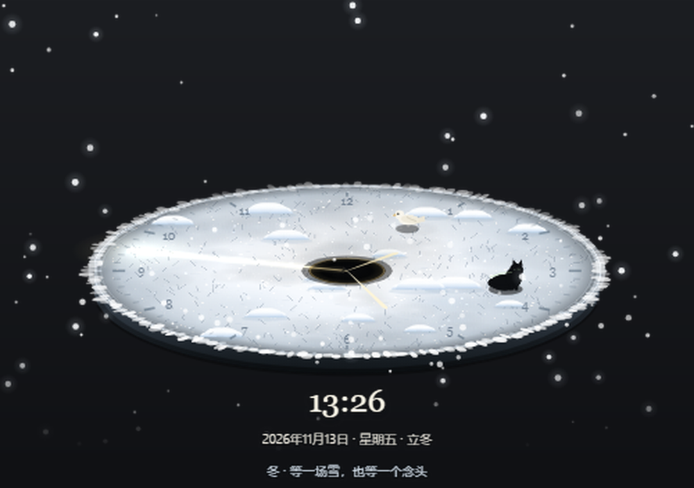
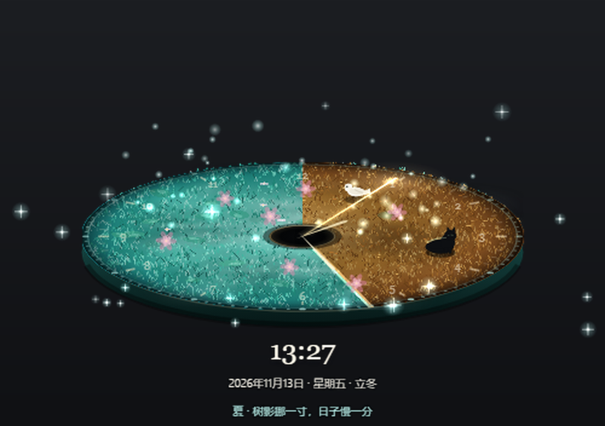
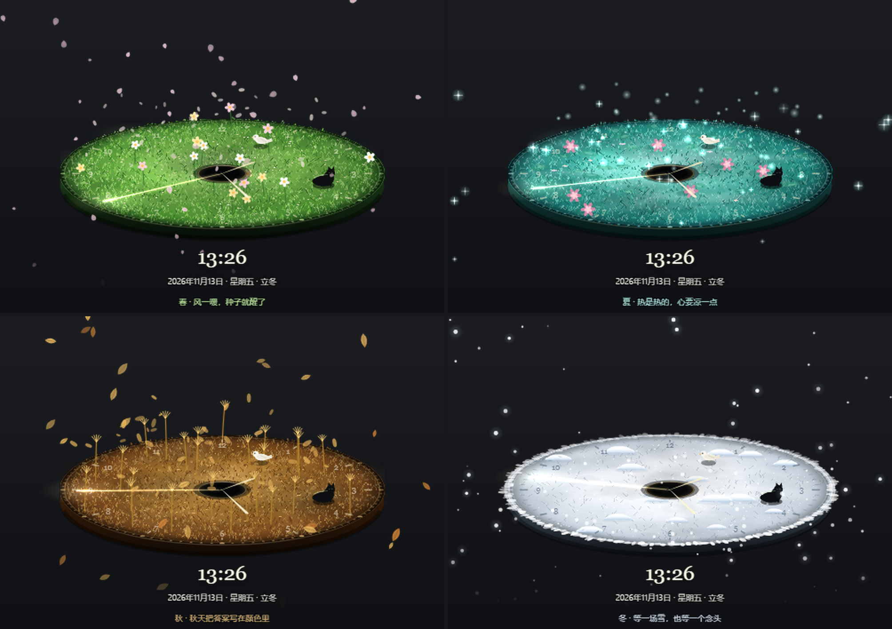

# SeasonDial · 四季转盘

<p align="center">
  
</p>

<p align="center">
  Windows 桌面四季时钟桌宠。<br />
  一块椭圆四季岛悬在桌面上，金色指针扫过地面，春绿 → 夏青 → 秋黄 → 冬雪依次铺开，盘下显示真实时间、日期与一句治愈语录。
</p>

<p align="center">
  <a href="README.en.md">English</a> ·
  <a href="docs/manual.zh-CN.md">完整使用说明（含菜单、语录全文、节气对照表）</a>
</p>

| 春 | 夏 | 秋 | 冬 |
| :---: | :---: | :---: | :---: |
|  |  |  |  |

换季时扫过盘面的金色楔形边界，以及「小 / 中 / 大」三档尺寸并排对照：

| 扫季瞬间 | 三档尺寸 |
| :---: | :---: |
|  |  |

---

## 它是什么

一个无边框、全透明、置顶的 Electron 窗口，全部画面用 Canvas 2D 手绘——没有图片素材、没有游戏引擎，只有一份 `main.js` 加一套原生 JS。

盘体是椭圆「四季岛」：草地圆盘 + 中央黑洞表盘 + 从盘心射向盘沿的金色光束（当秒针用）+ 一圈灯珠刻度 + 一只小黑猫和一只小白鸽。

画面上同时跑两套循环：

| 循环 | 效果 |
| --- | --- |
| **秒针**（60 秒一圈） | 金色光束绕盘心旋转，扫过的地方依次露出当季地面，光束尾部拖着一路颜色。 |
| **季节** | 默认每 60 秒整盘扫动换季一次，扇形边界清晰并带金色亮边：春 → 夏 → 秋 → 冬。 |
| **加速轮转**（可选） | 光束加速到 15 秒转完一圈，每转到 12 点方向就开始换季，四季在 15 秒内走完一轮；只是画面加速，盘下显示的时间照旧走。 |

## 特点

- **真实节气，认真算的** —— 「跟随真实季节」不是按月份粗分：用太阳视黄经（Meeus 低精度解）求出二十四节气在北京时间的具体时刻，再按立春/立夏/立秋/立冬切季。与官方历书核对 2025–2028：同一天，误差 1–13 分钟。
- **四季地面彻底区分** —— 嫩黄绿草地 / 正午明青水面（荷叶、睡莲）/ 土黄落叶地 / 纯白覆雪。
- **盘里的四季会长出来** —— 春天草地上抽出带茎的小花、夏天水面浮着荷花、秋天稻杆一节节长高、冬天堆起厚厚几片雪；换季时新一季的装饰从地面慢慢长出来，旧的一起退场。
- **猫走过会留脚印** —— 冬天地面是雪，小猫绕盘散步时身后会留下一串渐淡的爪印，26 秒左右被雪盖回去。
- **每季有各自的天气** —— 樱花花瓣、水面白闪光上浮、带叶脉的落叶、雪花；这些粒子飘到表盘下方时渐变淡出，不会在窗口底边生生断掉。
- **想快点看四季就开加速** —— 右键「季节 → 加速轮转」，15 秒一圈、每到 12 点换一季，纯视觉加速，不影响时钟读数。
- **猫和鸽子按点作息** —— 夜里猫蜷成团睡觉（飘 `z`）、鸽子把头缩进翅膀；白天猫 loaf 眨眼、鸽子踱步；黎明黄昏绕行、振翅。
- **原创治愈语录** —— 每季 6 条原创句子，26 秒随机轮换 + 淡入淡出，同季不连着重复，换季必换句。
- **任何壁纸上都看得清** —— 三行文字都带深色描边 + 紧凑投影，纯白窗口和深色桌面都不糊。
- **三档尺寸** —— 小 380×268 / 中 500×352 / 大 650×458，按窗口中心缩放并自动钳回工作区内。
- **占用低** —— 30fps 限帧 + 底层缓存 + 扫季只叠加扇形：实测 18%–23% 单核（16 核机器约 1.2%–1.5% 总占用），窗口不可见时直接停画。
- **能打赏** —— 右键菜单和托盘里都有「打赏作者」，点开是一张微信赞赏码，随时可以请作者喝杯茶。

## 下载

到 [Releases](https://github.com/92lyzxx/season-dial/releases) 下载 `SeasonDial-1.2.0.exe`。

单文件便携版，免安装、不需要管理员权限。因为未做代码签名，Windows 可能弹 SmartScreen：点「更多信息 → 仍要运行」。

## 自己编译

```bash
npm install
npm start          # 直接用 Electron 跑
npm run pack       # 打包便携版 exe 到 dist/
npm run icon       # 重新生成 build/icon.ico 与 assets/icon.png（需要 Python + Pillow）
```

国内网络建议先设镜像：

```powershell
$env:ELECTRON_MIRROR = "https://npmmirror.com/mirrors/electron/"
$env:ELECTRON_BUILDER_BINARIES_MIRROR = "https://npmmirror.com/mirrors/electron-builder-binaries/"
npm run pack
```

需要 Node 18+；只有生成图标时才需要 Python 3。

## 操作

| 动作 | 效果 |
| --- | --- |
| 左键按住拖动 | 移动桌宠，位置会记住 |
| 左键单击盘面 | 荡开一圈金色涟漪 |
| 右键 | 菜单：季节模式（自动 / 加速轮转 / 跟随真实季节 / 四季定格）、时钟/刻度开关、轮转间隔、窗口尺寸、置顶、鼠标穿透、开机自启、打赏作者、退出 |
| Esc / 点窗口外任意位置 | 菜单自动收起 |

首次启动窗口出现在**屏幕右上角**（留 24px 边距），之后按你拖动过的位置恢复。

## 打赏

<p align="center">
  
</p>

右键菜单 **支持 → 打赏作者**（托盘的右键菜单里也有同一项），点开就是这张微信赞赏码，手机扫一扫即可。窗口置顶、可拖动，点「关闭」或按 `Esc` 收起。

## 四季一览

| 季节 | 地面 | 天空 | 盘内动态元素 |
| --- | --- | --- | --- |
| 春 | 嫩黄绿草地 | 粉白樱花瓣飘落 | 带茎的小花从草地抽出，随风轻摆 |
| 夏 | 正午明青水面（亮青绿水 + 荷叶 + 睡莲） | 水面白闪光上浮 | 荷花一朵朵浮在水面，荷叶与涟漪随水晃 |
| 秋 | 土黄落叶地 | 枯叶飘落（带叶脉尖头） | 稻杆节节长高，顶端抽出稻穗 |
| 冬 | 纯白覆雪 | 雪花 + 柔光 | 一片片厚雪堆起，小猫走过留下串串爪印；盘沿积雪、刻度改深色 |

## 性能

1920×1080、默认中档、16 核机器实测：

| 指标 | 数值 |
| --- | --- |
| 帧率 | 30fps 限帧（源码运行可加 `?fps=60`） |
| CPU | 18%–23% 单核（约 1.2%–1.5% 总占用） |
| 内存 | 五进程工作集合计约 430MB |
| 隐藏时 | 停止绘制 |

内存属 Electron 基线，不是画布资源泄漏，长时间运行不会持续上涨；想再低只能换掉 Electron 原生重写。

## 目录结构

```
main.js                 # 窗口、托盘、IPC、窗口位置持久化
preload.js              # contextBridge -> window.pet.{send,invoke,on}
renderer/
  index.html
  style.css             # 右键菜单样式
  app.js                # 全部绘制：调色板、贴图、季节、猫鸽、指针、菜单
build/icon.ico          # Windows 图标，7 个尺寸，小尺寸用简化裁图
assets/icon.png         # 托盘图标
tools/                  # 开发用：离屏截图、节气探测、图标生成
docs/                   # 截图与使用说明
```

## 季节怎么算的

`solarTermOf(date)` 先用 Meeus 低精度公式解太阳视黄经，再把时间戳 +8 小时读成北京墙上时间，得到每个节气的具体时刻；季节以立春、立夏、立秋、立冬为界。`node tools/verify_terms.js` 会打印本版核对过的节气表。

## 许可

[MIT](LICENSE) © 2026 溪行

四季语录为本项目原创撰写。
